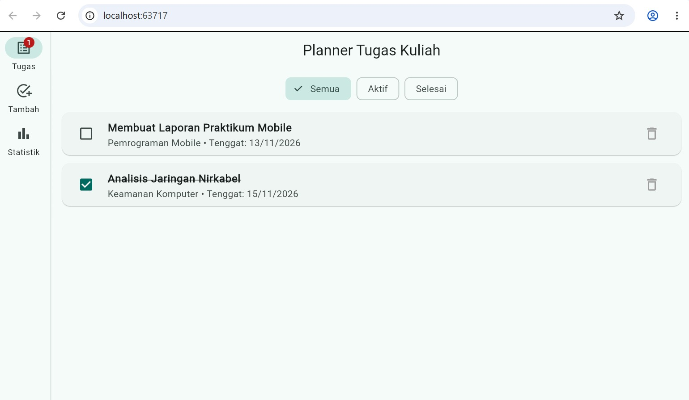
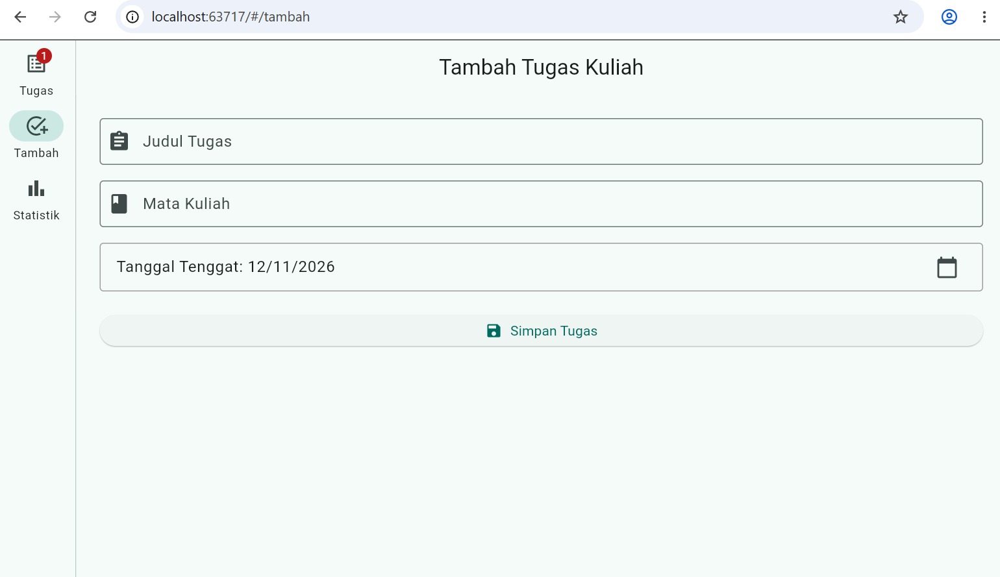
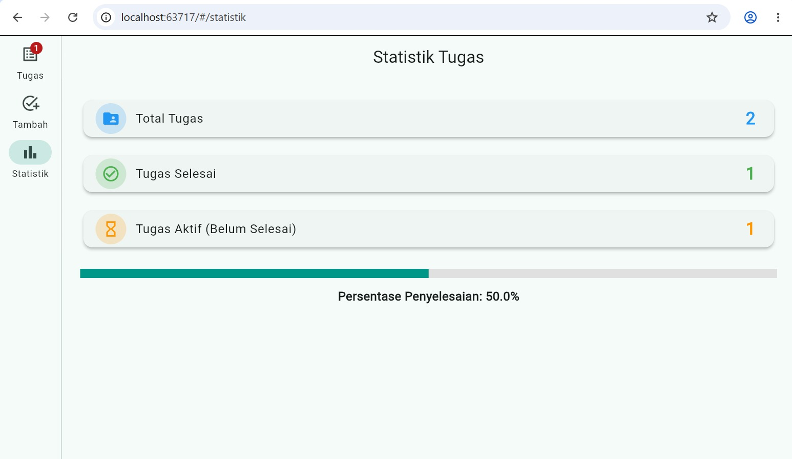

# Tugas Rutin 7: Planner Tugas Kuliah dengan State Management

## Identitas

- **Nama:** Sevta Simamora
- **NIM:** 4243250019
- **Kelas:** PSIK 24C
- **Program Studi:** Ilmu Komputer
- **Fakultas:** Matematika dan Ilmu Pengetahuan Alam, Universitas Negeri Medan
- **Mata Kuliah:** Pemrograman Mobile
- **Tugas:** Tugas Rutin 7

## Deskripsi

Planner Tugas Kuliah merupakan aplikasi pencatat tugas mahasiswa yang membantu pengguna mengelola tugas berdasarkan judul, mata kuliah, dan tenggat waktu. Aplikasi menyediakan fitur untuk menambahkan tugas, menandai tugas sebagai selesai, menghapus tugas, memfilter daftar tugas berdasarkan status, serta melihat statistik penyelesaian tugas.

Data tugas dikelola menggunakan Provider agar dapat digunakan bersama oleh halaman daftar tugas, form tambah tugas, dan halaman statistik.

## Teknologi

- **Flutter:** Framework untuk membangun aplikasi.
- **Provider (`ChangeNotifier`):** Mengelola state bersama dan memperbarui tampilan ketika data berubah.
- **`setState`:** Mengelola state lokal, seperti filter daftar tugas.
- **`TextEditingController`:** Mengambil dan mengelola input judul serta mata kuliah.
- **`go_router`:** Mengatur navigasi antarhalaman aplikasi.

## Screenshot

### 1. Halaman Daftar Tugas

Menampilkan daftar tugas kuliah dengan pilihan filter Semua, Aktif, dan Selesai. Pengguna juga dapat menandai tugas yang telah diselesaikan.



### 2. Halaman Form Tambah Tugas

Menampilkan form untuk memasukkan judul tugas, mata kuliah, dan tanggal tenggat.



### 3. Halaman Statistik

Menampilkan jumlah seluruh tugas, tugas yang selesai, tugas yang masih aktif, dan persentase penyelesaian tugas.



## Diagram State

```text
MaterialApp.router (Root)
          |
          v
ChangeNotifierProvider
       (TaskProvider)
          |
          v
       MainShell
      (go_router)
          |
    +-----+-----+
    |     |     |
    v     v     v
 Daftar  Form  Statistik
 Tugas  Tambah
    |     |     |
    |     |     +-- Membaca data Provider
    |     |
    |     +-- TextEditingController
    |         (state lokal)
    |         initState() / dispose()
    |
    +-- Data tugas dari Provider
    +-- Filter Semua/Aktif/Selesai
        (setState / state lokal)
```

## Lifecycle dan Alasan Memilih Provider

Aplikasi Planner Tugas Kuliah menggunakan Provider dengan `ChangeNotifier` untuk mengelola data yang digunakan bersama oleh halaman daftar tugas, form tambah tugas, dan statistik. Data tugas disimpan di dalam `TaskProvider`, sehingga setiap halaman dapat membaca sumber data yang sama. Ketika pengguna menambahkan tugas, mengubah status tugas menjadi selesai, atau menghapus tugas, Provider akan menjalankan `notifyListeners()` agar widget yang menggunakan data tersebut memperoleh pembaruan secara otomatis.

Provider dipilih karena mudah dipahami dan memiliki struktur pengelolaan state yang sederhana. Penggunaan Provider juga membantu memisahkan pengelolaan data dari tampilan sehingga kode lebih terorganisasi. State filter Semua, Aktif, dan Selesai hanya diperlukan pada halaman daftar tugas. Oleh karena itu, filter dikelola secara lokal menggunakan `setState` dan tidak perlu dimasukkan ke dalam Provider.

Pada halaman form tambah tugas, `TextEditingController` digunakan untuk mengambil input judul dan mata kuliah. Controller dibuat ketika halaman mulai digunakan melalui `initState()`. Setelah halaman tidak digunakan lagi, `dispose()` dipanggil untuk melepaskan controller agar sumber daya tidak terus digunakan. Setelah data berhasil divalidasi, tugas dikirim ke Provider untuk disimpan. Halaman statistik kemudian membaca data dari Provider dan menampilkan jumlah tugas serta persentase penyelesaian. Dengan pembagian tersebut, state bersama dan state lokal memiliki tanggung jawab masing-masing.

## Pengujian

Pengujian dilakukan untuk memastikan fitur pengelolaan tugas berjalan sesuai fungsinya, meliputi:

1. Menambahkan tugas baru melalui halaman form.
2. Menandai tugas sebagai selesai.
3. Menghapus tugas dari daftar.
4. Memfilter tugas berdasarkan status Semua, Aktif, dan Selesai.
5. Memastikan statistik berubah ketika data tugas diperbarui.

Jika unit test sudah tersedia, jalankan perintah berikut dari terminal pada direktori proyek:

```bash
flutter pub get
dart format lib test
flutter analyze
flutter test
flutter run
```

## Kesimpulan

Aplikasi Planner Tugas Kuliah menerapkan pengelolaan state menggunakan Provider dan `ChangeNotifier` untuk menyimpan serta memperbarui data tugas secara bersama. Sementara itu, `setState` digunakan untuk kebutuhan state lokal dan `TextEditingController` digunakan untuk mengelola input pada form. Penerapan tersebut membantu memahami perbedaan state bersama dan state lokal, serta penggunaan lifecycle pada StatefulWidget dalam pengembangan aplikasi Flutter.

## Pernyataan Penggunaan AI

AI digunakan sebagai alat bantu dalam menyusun kerangka proyek, memahami konsep Provider, `ChangeNotifier`, lifecycle StatefulWidget, serta membantu menyiapkan dokumentasi. Kode dipelajari, disesuaikan, dan diuji kembali oleh mahasiswa.